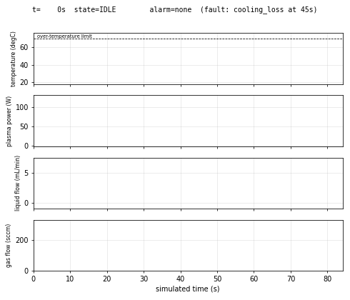
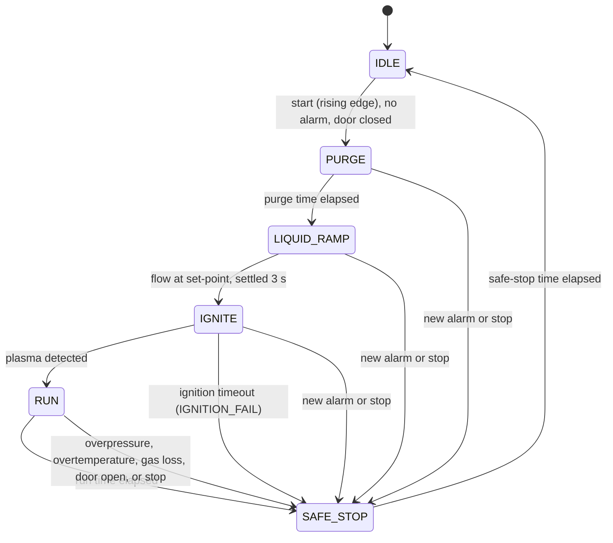
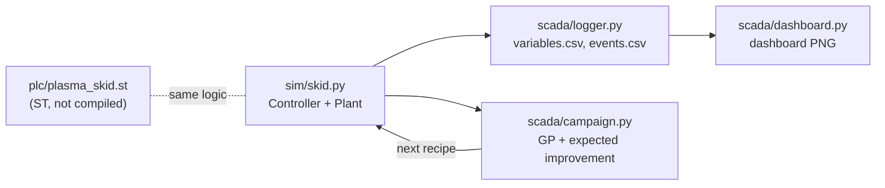
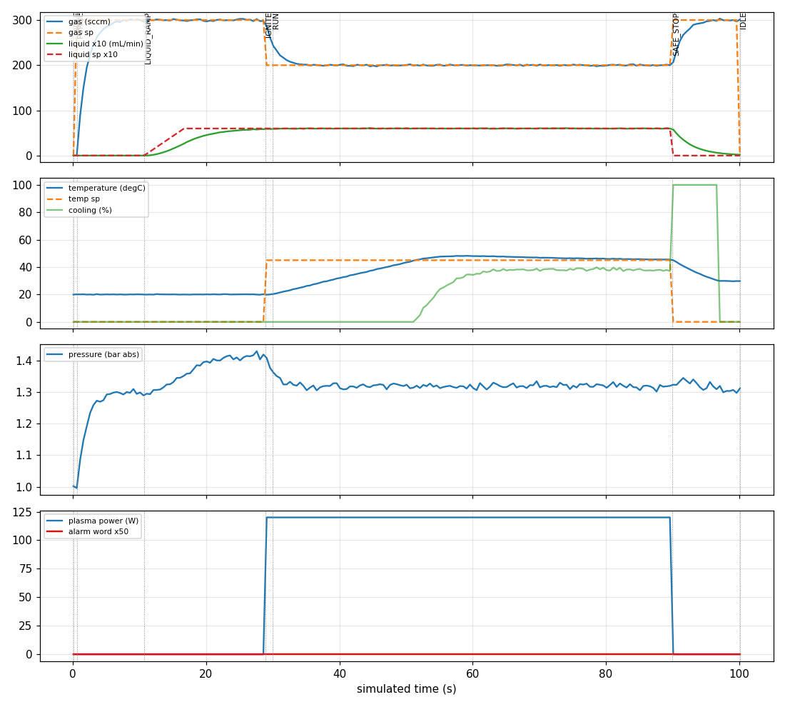
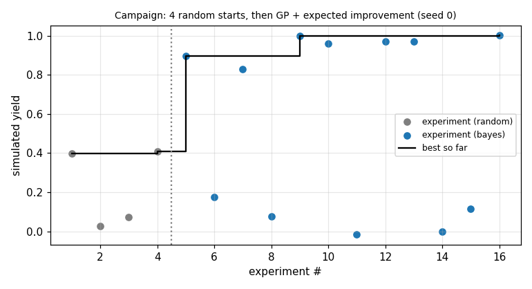

# plasma-flow-skid-control

-blue)
-brightgreen)


Control and supervision layers of a continuous-flow cold-plasma reactor skid, built on a **simulated process**:
an IEC 61131-3 sequence with interlocks, a tested Python twin of it, a CSV journal and dashboard, and an
autonomous Bayesian experiment campaign.

What this shows:

- **PLC logic** - a Structured Text program (`plc/plasma_skid.st`): state sequence, two PID loops, latched alarms and interlocks, recipes.
- **Tested digital twin** - `sim/skid.py` mirrors the ST logic and runs against a first-order plant model with fault injection; 16 pytest tests.
- **Supervision** - timestamped variable journal, alarm/state event log, matplotlib dashboard.
- **Autonomous campaign** - Gaussian-process + expected-improvement search over recipe parameters, each experiment being a full simulated batch.



*Real run of the simulator: cooling is lost at t = 45 s, temperature climbs to the 70 degC limit, the interlock cuts the plasma and the sequence goes to `SAFE_STOP`.*

## Background

A small personal demo of the control and supervision layers of a continuous-flow cold-plasma reactor skid,
built on a **simulated process**. No real hardware, no real chemistry: the plant is a set of first-order
models with noise. The point is the control logic and the tooling around it.

Motivation: I worked on a plasma process (HiPIMS magnetron sputtering) and on Gaussian-process
optimisation, and wanted to show how I would structure the automation of a plasma lab prototype:
sequence, safety, supervision, and autonomous experiment campaigns.

## Architecture

```
 plc/plasma_skid.st         IEC 61131-3 Structured Text program (the "real" logic)
        ^  same logic, tested
 sim/skid.py                Python twin of the ST program + process simulator (no PLC needed)
        |
 scada/logger.py            timestamped CSV journal: variables + alarm/state events
 scada/dashboard.py         matplotlib dashboard rendered to PNG
 scada/demo.py              one batch, optional injected fault
 scada/campaign.py         autonomous campaign: GP + expected improvement picks the next recipe
```

Planned, **not implemented**: PLC <-> SCADA link over Modbus/TCP (OpenPLC exposes the %IW/%QW/%MW
registers used in the ST file) or OPC UA; today the supervision reads the Python twin directly.

### State machine



Gas loss and door open are only monitored in the active states (`PURGE` to `RUN`); overpressure and
overtemperature latch an alarm in any state, which then blocks the next start until acknowledged.

### Data flow



### Controller (ST and Python twin)

- Sequence: `IDLE > PURGE > LIQUID_RAMP > IGNITE > RUN > SAFE_STOP > IDLE`
  (gas purge, liquid flow ramp and settle, plasma ignition with timeout, regime for the recipe duration,
  plasma off with gas purge and forced cooling).
- Two PID loops: liquid flow (pump) and temperature (cooling, reverse-acting). Derivative on
  measurement, clamped integrator for anti-windup.
- Interlocks, any of which cuts the plasma and goes to `SAFE_STOP`: overpressure, gas flow loss
  (debounced), overtemperature, door open, ignition failure.
- Alarms are latched. Acknowledge only clears alarms whose cause is gone; start is refused while an
  alarm is latched or the door is open.
- Recipes: set-points (gas, liquid, power, temperature, durations) are parameters, loaded on a
  `recipe_load` command and only accepted in `IDLE`.

## Run

```
pip install -r requirements.txt
python -m pytest                              # 16 tests
python -m scada.demo                          # nominal batch -> out/demo/{variables,events}.csv, dashboard.png
python -m scada.demo --fault cooling_loss     # also: gas_loss, blockage, door_open
python -m scada.campaign --n-iter 12          # 4 random + 12 Bayesian experiments -> out/campaign/campaign.csv
```

Figures (`docs/img/`) are regenerated from real simulator runs with `python docs/make_figures.py`.




## Tests

`tests/test_skid.py` (14 tests, including parametrised cases):

- nominal batch: set-points reached, no alarm, and the exact state order `PURGE > LIQUID_RAMP > IGNITE > RUN > SAFE_STOP > IDLE`;
- each interlock (blockage, gas supply loss, cooling loss, door open) trips to `SAFE_STOP` with plasma, power and pump off and the right alarm bit set;
- ignition failure, stop button, alarm latching after the cause is gone, start refused while latched, acknowledge refused while the condition persists, start refused with the door open;
- recipes accepted only in `IDLE`;
- PID convergence on a first-order plant and reverse-acting (cooling) behaviour;
- the demo writes the CSV journal and the dashboard, with the `OVERPRESSURE` event logged.

`tests/test_campaign.py` (2 tests): the simulated yield peaks near the hidden optimum, and a campaign
improves on its random start and reaches > 0.85 of the simulated optimum.

## Limits

- The process is simulated; the models and the "yield" function (a hidden optimum in power and liquid
  flow) are invented for the demo and say nothing about real plasma chemistry.
- **The Structured Text file has not been compiled or run on any PLC runtime** (no matiec/OpenPLC in
  my environment). It is written for OpenPLC's matiec subset (scaled INT I/O, `%MW` recipe, standard
  `R_TRIG`) and mirrors the Python twin, which is the part that is tested. Expect small syntax fixes
  on first compile.
- No real-time guarantees, no hardwired safety chain: a real skid needs an independent safety
  circuit; software interlocks are not a substitute.
- The campaign loop is a basic GP + expected-improvement optimiser over two parameters, without
  constraints, batching or failure modelling.
